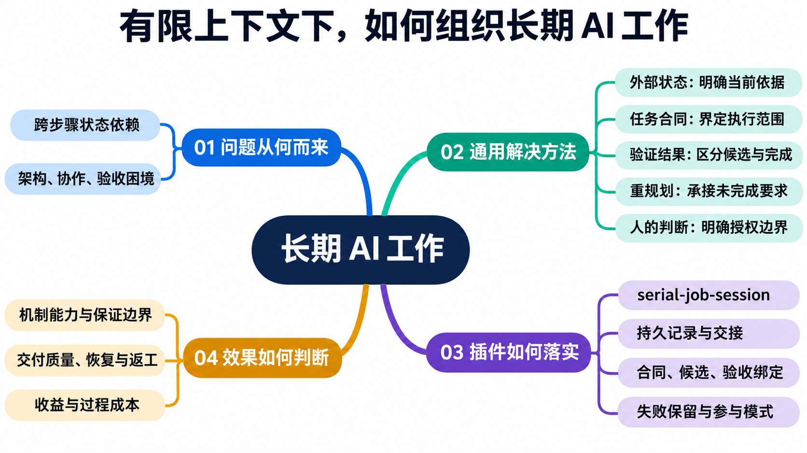
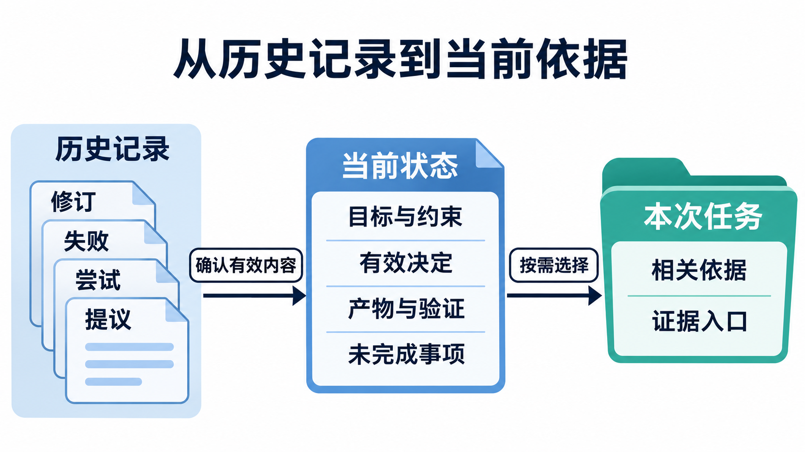
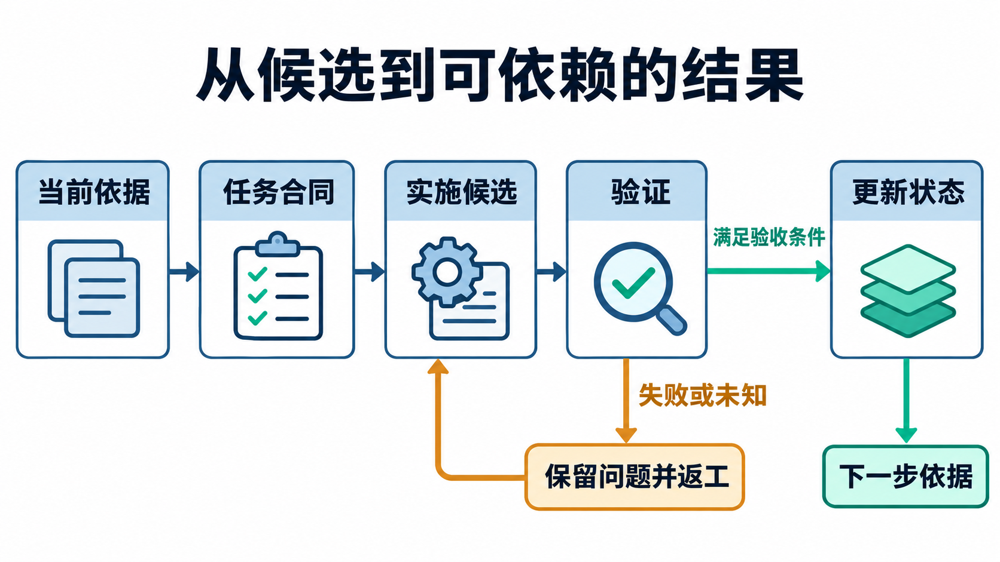

# 有限上下文下，如何组织长期 AI 工作

阅读提示：核心概念 · 方法原则 · 限制与风险。颜色仅作辅助，正文含义不依赖颜色。

文章导图：从长期工作的共性问题，推导通用方法，再看插件实践与效果验证。

　　AI 能快速完成局部任务，但长期交付要求许多次执行**共同满足一个目标**。代码已经写好，不代表原有行为得到保留；每张任务卡都已完成，也不代表系统可以交付。

　　这种落差来自<strong>执行之间的依赖</strong>。后续工作既要继承前面的成果，也要继承当时的**约束、未解决的问题和验证责任**。只要这些信息在交接中失真，局部进展就可能偏离整体目标。

　　因此，组织长期 AI 工作，需要解决一个连续的问题：如何让每次执行获得**正确依据**，再让执行**结果经过验证**，成为下一步可以依赖的状态。

## 一、为什么局部能力不能直接累积成长期交付

　　单次执行可以围绕给定信息完成一个局部目标。长期工作却要求后续执行承接前面形成的决定、产物和验证结论，同时继续遵守整体约束。只要后一步依赖这些内容，前一步是否正确，就会影响后一步判断的基础。

　　因此，长期工作的关键特征是<strong>跨步骤的状态依赖</strong>。持续时间和会话数量会增加维护难度，但即使只有少数步骤，也可能存在这种依赖。局部能力能够发挥多大作用，取决于每次执行能否获得足够且有效的工作依据。

　　扩大上下文可以容纳更多材料，却不能自动完成这种维护。聊天历史同时包含提议、尝试、失败和修订，接手者仍需**判断哪些内容有效**。摘要缩短了材料，也可能**省略决定依据和例外条件**。信息读得快、放得下，与能否据此正确行动，是不同的问题。

　　由此形成三类困境：**架构上**，局部修改可能遗漏其他模块的约束；**协作上**，人需要反复补充背景并跟上变更；**验收上**，实现者认为完成的内容，未必满足最终交付条件。

　　如果始终由人补齐这些缺口，人就承担了外接记忆、跨模块判断和持续核验的工作。要减少这部分负担，就需要让工作依据能够**脱离某一次会话持续存在**。

## 二、从保存历史，到维护当前工作状态

　　外部记录首先解决的是**交接依据**。无论谁接手，都应能查到当前目标、有效决定、相关产物、验证状态和未完成事项，而不必从全部对话中重新推断。

　　但仅仅把聊天存成文件还不够。历史中的提议尚未成为决定，实施结果尚未经过验收，过去有效的结论也可能已经被修订。接手者需要知道哪些内容可以作为依据，仅凭“曾经记录过”无法作出这个判断。

　　因此，需要同时保留<strong>历史与当前状态</strong>。历史说明发生过什么以及为什么改变；当前状态说明现在以什么为准。它至少应回答：

- **目标和约束**是什么，哪些决定仍然有效；
- 当前使用哪个**产物版本**，有哪些验证依据；
- 哪些要求**失败、未知或尚未处理**；
- **下一步依赖什么**，可以在什么范围内行动。

　　这让交接从“重新理解所有过去”转为“<strong>确认当前依据，再按需追溯</strong>”。相关记录应提供原始材料和证据入口，不能用摘要代替全部依据。

图1：保留历史，维护当前有效状态，再为本次任务选择相关依据。

　　外部状态也不能无限加载。只有**围绕当前任务选择信息**，才能减少无关历史、过期结论和重复阅读。因此，维护外部状态之后，还需要解决一个问题：如何界定当前这一步应当知道什么、完成什么。

## 三、用任务合同界定一次执行

　　当前状态说明工作已经进行到哪里，却不能单独决定下一次执行的范围。执行者还需要知道本次要形成什么结果、受哪些约束，以及用什么条件判断完成。这组关于**目标、交付物、约束、依赖和验收条件**的约定，可以称为任务合同。

　　合同同时提供**信息选择与结果判断的边界**。执行者据此选择相关材料，评审者据此检查结果，接手者据此区分已经履行和仍未履行的要求。如果完成标准只存在于某次对话中的临时理解，换会话后就容易发生偏移。

　　合同不要求在开工前消除所有未知。对尚不能确定的内容，可以约定需要回答的问题、必须提供的依据和后续决策条件。关键是明确本次工作的责任范围，使探索结果与已确认结论保持可区分。

　　拆分粒度由这种判断需要决定。具有独立结果、依赖和验收条件的工作适合建立任务；同一次实施中的编译、截图和自检通常无需逐项建卡。**拆得过粗难以定位失败，拆得过细则增加管理成本**。

　　不过，拆分只能缩小单次工作的范围，不能消除任务之间的关系。子任务的验收只证明各自约定的条件得到满足，不能自动证明组合后的行为正确。因此，整体目标与系统约束需要在拆分后继续保留，并安排<strong>集成和最终交付验证</strong>。

　　合同由此明确了“应该完成什么”，但执行者声称完成，并不能证明合同已经满足。下一步必须区分**产物与被验证的结果**。

## 四、让候选通过验证后再成为后续依据

　　**实施结果首先是**<strong>候选</strong>。只有按合同检查实际产物，才能判断它是否可以被后续工作依赖。否则，一个未经验证的假设可能沿着依赖链传播，直到交付阶段才暴露。

　　验证结论必须关联<strong>要求版本、产物版本和证据</strong>。只有知道依据哪组要求、检查了哪个产物，才能判断结论的适用范围。要求或产物改变后，原证据是否仍然有效，需要重新确认。

　　检查结果应区分**通过、失败与未知**。未执行或证据不足的检查应保持未知，不能随着任务推进被默认视为通过。总体评分也不能抵消未满足的必需条件，否则“看起来接近完成”就会取代原来的交付要求。

　　独立评审有助于检查实现者的遗漏，但<strong>角色分开不保证判断正确</strong>。评审者需要回到**原始要求、真实产物和适当证据**，避免只复述实现者的完成说明。证据形式应由待验证的要求决定；难以形式化的质量判断，也需要明确其判断者、依据和适用范围。

图2：候选满足验收条件后，才更新为下一步依据；失败或未知保留问题并返工。

　　到这里，工作可以形成一个循环：**明确当前依据和合同，实施候选，验证结果，更新状态**，再进入下一步。但长期项目还会改变方案，固定合同并不足以应对这种变化。

## 五、调整方案时，延续尚未完成的要求

　　规划建立在当时掌握的信息上，执行又会产生新证据。原方案不再成立时，继续推进需要调整路径。但实现路径与完成标准承担不同作用：路径说明怎样达到目标，标准说明什么才算达到目标。路径失效，不会自动免除原有要求。

　　因此，重规划既要说明改变路线的依据，也要交代原有要求在新计划中的去向。<strong>未完成义务应由后续任务明确承接</strong>；确需变更的要求，应由有权决定的人接受并修订合同，不能在重拆任务时静默省略。

　　新路线还可能改变旧验收成立的前提。除了承接未完成要求，还需要判断哪些既有结论必须复核。否则，即使每次局部修改都通过了检查，整体状态也可能逐渐偏离最初的交付目标。

　　**失败记录**也应保留。它说明哪些前提不成立、哪些尝试不宜重复，并为后续恢复提供依据。**返工需要预算**；耗尽后应明确停止、升级处理或继续独立工作，不能通过不断改写任务制造完成。

　　版本与状态关系可以由程序检查，新旧合同是否覆盖相同义务、哪些旧结论因变更而失效，则需要语义判断。工作规则能够要求这些判断发生，不能自动保证判断充分。人的参与边界也需要据此确定。

## 六、把人的判断放在明确的位置

　　当工作不能全部转化为确定性检查时，流程还必须规定由谁作出判断，以及判断依据是什么。目标取舍、重要方向变化、难以形式化的验收和超出授权的操作，通常需要明确的人类参与安排；已获得授权的执行与检查，则可以按约定继续。

　　<strong>提前约定这些边界</strong>，可以避免每一步都等待确认，也可以使影响后续工作的关键决定及时进入人的视野。人的参与程度应随任务性质、风险和授权确定。

　　**授权程度与执行能力应分别判断**。允许 agent 自主决策，意味着它可以在约定范围内尝试，也可以如实报告失败；这不等于获得成功保证。遇到未知时，流程应保留未知，而不是为了继续推进将其改写为通过。

　　为了使必要的人类判断有依据，汇报应说明**结果、证据、关键变化和待决事项**。日志支持恢复与追溯，汇报帮助人更新对项目的理解，二者不能互相替代。

　　至此，长期工作的组织方式才比较完整：外部状态承接事实，合同界定执行，验证决定哪些结果可以被依赖，重规划承接未完成要求，授权规则安排人的参与。这些环节**共同维护工作连续性**。

　　它们也都有成本。简单任务可能只需明确要求和结果检查；交接、返工与失败成本较高的工作，才更值得引入完整流程。是否有效，应看**最终交付、恢复效率、遗漏与返工**，以及额外的**时间和维护成本**。

## 七、从通用方法到 [serial-job-session](https://github.com/FMJ9922/serial-job-session)

　　上述方法可以通过**项目文档、脚本、工作流框架或定制 skill** 落实。Anthropic 的长期 agent harness 使用持久进度与功能清单组织跨上下文工作；AstronOS 研究以版本化状态承接跨会话任务，为这条路径提供了工程参考。[1][2]

　　通用运行时可以提供持久执行、恢复和人工介入等基础能力，具体交付规则仍需应用者定义，LangGraph 的官方定位体现了这种分工。[3] 定制 skill 则可以将团队对候选、评审和失败处置的选择固化下来。

　　[serial-job-session](https://github.com/FMJ9922/serial-job-session) 是面向跨天、跨周商业交付的 **AI 辅助编排插件**。它把**共享方法与项目事实分开**：skill 定义协议，项目实例保存目标、合同、候选、评审和失败；CLI 检查控制状态。其具体做法对应了前面推导出的几个要求。

　　**记录与恢复。** 控制日志只追加，当前状态可以重建。context 与 handoff 输出当前合同、直接依赖、反馈和相关经验，证据正文按需读取。工作依据由项目记录承接，减少对某次会话记忆和聊天摘要的依赖。

　　**程序检查。** CLI 将评审绑定到合同与候选版本，新候选不能直接沿用旧验收；必验项失败、未知或没有证据引用时，不以总分放行。它还检查 reviewer 是否为实现贡献者，以及必需依赖和子任务是否已验收。

　　**决策与承接。** 人工主导、条件自治和全 AI 三种模式约定开工、方向与验收的决策方式。合同修订保留版本，删改必验项需要真实人类批准；协议要求重规划时明确承接未完成义务。返工耗尽后，按已选策略停止或继续独立任务，并保留成果。

　　这些机制为前述方法提供了执行载体。其侧重点是减少反复重建背景，约束完成声明，并使失败与未完成事项在交接后继续可见。

## 八、机制成立与效果成立之间，还有运行验证

　　serial-job-session 的保证范围限于现有机制。CLI 检查通过它提交的版本、状态、依赖和必验项记录，<strong>不能自动证明证据真实、测试充分或新合同完整覆盖旧义务</strong>。授权与身份是来源记录，实际权限执行依赖宿主；日志可重建也不等于外部操作可以安全重放。

　　相邻研究说明这条路径值得考察，但<strong>不能替代插件自身的效果证据</strong>。例如，AstronOS 的交接实验针对受控的软件更新计划任务，不能直接推广为完整软件交付的保证。[2]

　　因此，评价这套插件，需要在可比任务中观察它是否减少交接成本、遗漏和返工，是否改善最终交付，以及**收益能否覆盖过程成本**。后续优化也应由这些实际表现推动。

　　无论采用哪种工具，长期 AI 工作都需要维持这条关系：每一步从**有效依据**出发，**结果经验证**后进入后续工作，**未完成的要求在变化中继续被承接**。这也是局部执行能否积累为可交付成果的判断标准。

## 参考资料

1. [Anthropic：Effective harnesses for long-running agents](https://www.anthropic.com/research/effective-harnesses-for-long-running-agents)
2. [AstronOS：A Unified Execution Model and Runtime for Long-Horizon Agentic Systems](https://arxiv.org/html/2608.16381v1)
3. [LangGraph 官方文档](https://docs.langchain.com/oss/python/langgraph/overview)
